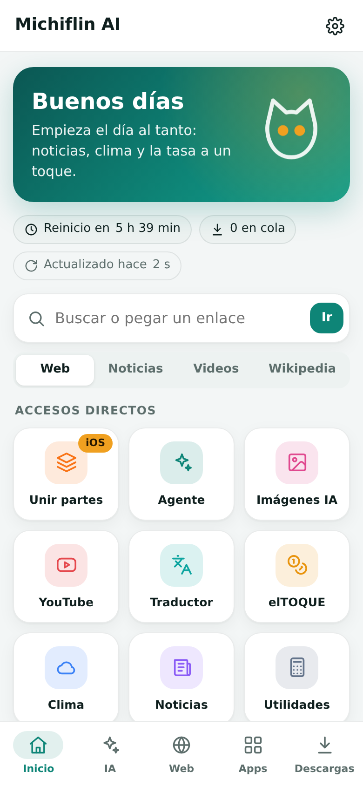
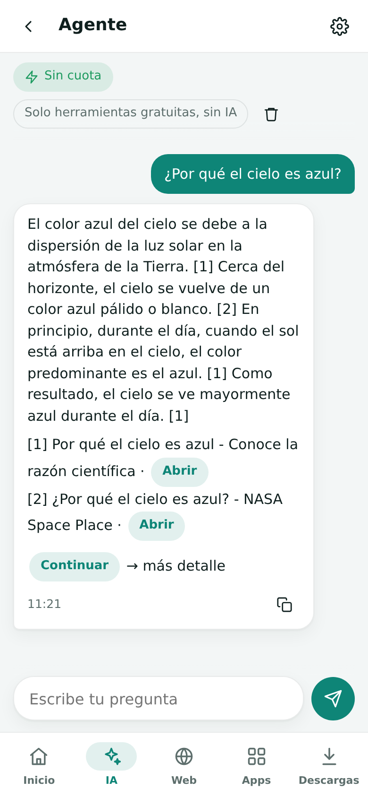

# Michiflin AI (español)

**Tu internet por correo.** Michiflin AI es un bot privado de [Delta Chat](https://delta.chat) que busca, lee páginas web, responde con modelos de IA gratuitos, crea imágenes y descarga archivos, y lo entrega todo como mensajes pequeños en el chat. Está pensado para buzones con poca cuota y conexiones lentas y caras.

Este documento es un anexo breve. La documentación completa está en inglés: [README](README.md) y [guía de uso](docs/GUIDE.md).

  
  
  
  

## Qué ofrece

- **Una miniapp para todo.** El bot envía una app WebXDC en el primer contacto, con una bienvenida que explica cómo usarla, y todo se hace ahí: inicio, IA, web, apps, descargas y ajustes. La primera vez que se abre muestra una introducción breve. Al chat solo llegan los archivos y medios entregados.
- **Un agente que no necesita IA.** Escribe normal o pega un enlace; el agente busca, lee las fuentes y arma la respuesta con frases citadas, además de calculadora, clima, tasas, traducción y resúmenes. Nunca llama a un modelo de IA, así que no toca ninguna cuota.
- **Solo IA gratuita.** Reparte las consultas entre planes gratuitos, con cuotas por modelo y relevo automático. Cada modelo en pausa dice por qué: límite alcanzado, clave rechazada o ya no es gratis, y el bot avisa cuando un modelo se detiene o vuelve. Puedes elegir el modelo exacto de cada imagen. Cada chat de modelo muestra el logo de su creador y acepta los adjuntos que ese modelo puede leer: fotos, PDF y documentos, y audio en Gemini.
- **Navegación ligera.** Las páginas llegan como texto compacto con enlaces que se tocan. PDF y capturas nítidas a pedido. Búsqueda en la web, noticias, videos o Wikipedia con el buscador normal (sin límites), o cambia la barra al buscador avanzado cuando necesites mejores resultados.
- **Descargas a la medida del buzón.** Videos, audios y archivos llegan en partes pequeñas. Las de video y audio se reproducen solas; las demás son partes numeradas con huella SHA-256. Los archivos `.xdc` descargados llegan como mini apps que se abren en el chat.
- **Reparto justo.** Si varias personas autorizadas usan el bot, las descargas y los envíos se turnan: va primero quien tiene menos trabajos en curso y ha recibido menos hoy. Cada persona tiene un máximo de descargas a la vez y una cuota diaria opcional que solo la pasa al final de la fila. La IA también se reparte: cada persona tiene un cupo diario de consultas, imágenes y proyectos del Programador, hace una consulta a la vez y ve en la app cuánto le queda; cuando queda poca IA gratis en el día, una reserva guarda los modelos grandes para la administración.
- **Unir partes en cualquier teléfono.** Una herramienta integrada ordena las partes sola, aunque el teléfono les cambie el nombre, las verifica y las une, incluidos los segmentos de video y audio en un solo archivo reproducible.
- **Programador.** Describe un programa o una página web; los modelos gratis de código escriben los archivos, los ejecutan en un entorno aislado sin internet ni claves y corrigen errores hasta que las pruebas pasan. Prueba las páginas dentro de la app y exporta las mini apps de Delta Chat como archivos `.xdc` listos para abrir y con el nombre del proyecto (o el código en ZIP). Si solo le preguntas algo, responde sin programar.
- **Útil sin IA.** Traductor, conversor de unidades, hora local, clima, titulares, tasa informal y calculadora.
- **Privado.** Solo responde a direcciones autorizadas; los remitentes desconocidos se bloquean sin respuesta.
- **Administración.** Un panel en vivo muestra CPU, memoria, disco, red, tiempos de respuesta, la cola y la sesión del servidor, ejecuta una prueba de rendimiento acotada y muestra qué parte del tráfico usa cada persona (solo cantidades, nunca el contenido) para detectar el uso desproporcionado.

## La miniapp

  
  

Recorrido (<a href="docs/media/es/clip-tour.mp4">MP4</a>) · Buscar y leer (<a href="docs/media/es/clip-web.mp4">MP4</a>)

| Pestaña | Para qué sirve |
|---|---|
| **Inicio** | Buscador, accesos directos, estado de la cola y tiempo hasta el próximo reinicio |
| **IA** | Agente, rotación automática, estudio de imágenes y un chat por modelo con usos restantes |
| **Web** | Resultados del buscador elegido, lector, historial, PDF, captura y descarga |
| **Apps** | YouTube, traductor, tasa, clima, noticias, utilidades, estado y administración |
| **Descargas** | Cola con progreso: pausar, seguir, cancelar, reintentar y reenviar; la pestaña muestra cuántas descargas siguen en curso |
| **Ajustes** | Idioma y tema de la app, buscador por defecto, los ajustes del bot (cada persona tiene los suyos; el grupo *Para todos* lo ve y cambia solo el administrador) y borrado de datos |

  
  
  
  

## Descargas y unir partes

  
  

Descarga (<a href="docs/media/es/clip-download.mp4">MP4</a>, acelerado) · Unir partes (<a href="docs/media/es/clip-join.mp4">MP4</a>)

- Los videos y audios largos llegan como segmentos `Película (1-5).mp4`; cada uno se reproduce solo y lleva su número dentro.
- Los demás archivos llegan como partes `.001`, `.002`…; la última trae la huella SHA-256 del archivo completo.
- En iPhone y iPad, **Unir partes** las ordena, las junta, comprueba la huella y exporta el archivo a la galería, Archivos u otro chat. Los segmentos MP4, M4A y MP3 se unen en un solo archivo reproducible.
- Guarda las partes en **Archivos**, no en Fotos: Fotos les cambia el nombre y puede recodificarlas.

## Uso del chat

Por defecto todo funciona **solo desde la miniapp**: lo que se escriba en el chat recibe una respuesta corta que apunta a la app, y `/app` envía una copia nueva. Las notas de voz, fotos y documentos enviados al chat se siguen procesando.

El ajuste **Uso del chat** → *App y comandos* activa el modo clásico, con comandos en español e inglés (`/ayuda`, `/web`, `/buscar`, `/bajar`, `/ia`, `/traducir`, `/clima`, `/tasa`, `/ajustes`…). La lista completa está en la [guía](docs/GUIDE.md#classic-chat-mode).

## Instalación

La configuración y la puesta en marcha se describen en el [README](README.md#configuration). Solo `OWNER_ADDRESS` es obligatoria; las claves de IA son opcionales y siempre de planes gratuitos.

## Licencia

Todos los derechos reservados. El código se publica solo para leerlo y aprender; ejecutarlo para otras personas o redistribuirlo requiere permiso. Consulta [LICENSE](LICENSE).
