# Michiflin AI · User guide

This guide walks through the mini app and the chat features. For setup and configuration see the [README](../README.md).

- [Getting started](#getting-started)
- [Home](#home)
- [AI](#ai)
- [Web](#web)
- [Apps](#apps)
- [Downloads](#downloads)
- [Joining parts on iPhone and iPad](#joining-parts-on-iphone-and-ipad)
- [Settings](#settings)
- [Status and administration](#status-and-administration)
- [Classic chat mode](#classic-chat-mode)
- [Saving data](#saving-data)
- [Privacy](#privacy)

## Getting started

1. Open the chat with the bot in Delta Chat. Only authorized addresses get answers.
2. The bot sends the mini app as soon as the chat is set up, with a short welcome explaining that the app is the whole bot; tap **Start** to open it. The first time, a brief introduction shows the tabs and how answers arrive (you can watch it again from **How it works**). If you lose the app, send `/app` for a fresh copy. Pin the chat or keep the app message at hand.
3. Use the app for everything. Every action is sent to the bot as a small message inside the same chat, and the answer comes back to the app, usually within a few seconds to a couple of minutes.

You can close the app at any time: pending work completes and shows up when you return. The indicator at the top shows requests in progress, and a request with no answer after a few minutes is marked so you can retry it.

Text written in the chat itself only gets a short reply pointing to the app. Files you send (voice notes, photos, documents) are still transcribed or analyzed.

## Home

  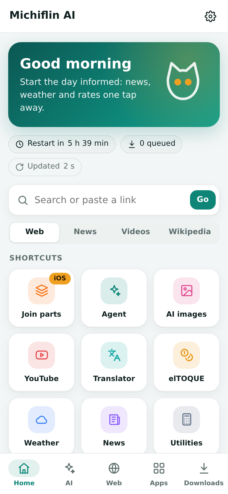
  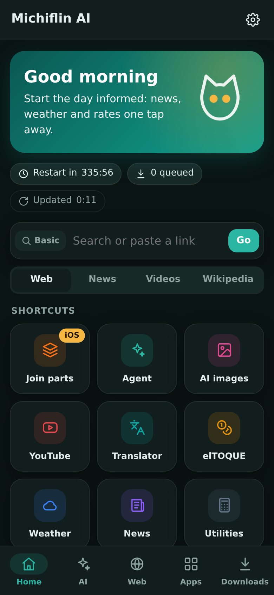

- **Search box:** type a search or paste a link. The chips below choose Web, News, Videos or Wikipedia. The button at the left of the bar switches between the **standard** engine (keyless, no limits, the default) and the **advanced** engine (better results, daily limit).
- **Status chips:** time until the next server restart, items in the queue and the last update.
- **Shortcuts:** the most used apps, one tap away.

The theme follows the device (light or dark) unless you choose one in Settings.

## AI

  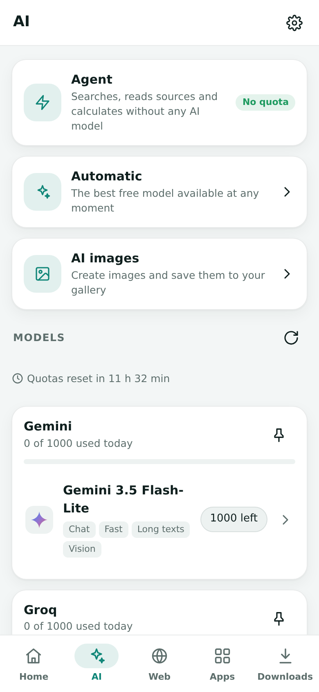
  
  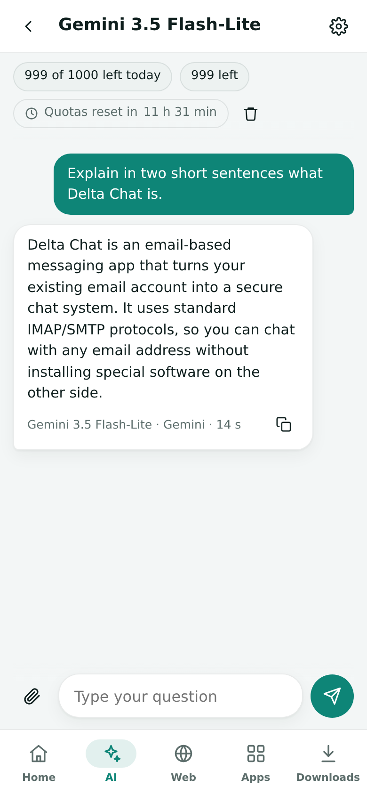

The AI tab has four spaces and a list of models:

- **Agent:** works on its own and never calls an AI model, so it spends no quota. It searches, reads the best sources and answers with their most relevant sentences, each with its source number. It also handles math, conversions, time, weather, rates, translation and page summaries (paste a link and ask for a summary). Answers take a few seconds.
- **Automatic:** always uses the best free model available.
- **Coder:** builds small programs and web pages (see below).
- **AI images:** a small studio to create images. Choose **Automatic** or one exact model; each chip shows today's uses. Cloudflare models share one free daily budget; when it is spent, all of them pause until it renews (00:00 UTC) and the studio says so.
- **Models:** each model has its own chat, showing remaining uses and the daily reset time. Only successful answers count as uses. A paused model says why: limit reached (with the wait), key rejected (the provider key must be renewed) or no longer free; models that cannot work are dimmed. The bot checks each provider once a day and sends a notice when a model stops working, stops being free or comes back.
- **Attachments:** the clip in a model chat attaches one file. Photos are shrunk automatically and go to models that can see (Gemini, Ministral). PDFs are read natively by Gemini and as text by the others. Documents (TXT, Markdown, CSV, JSON, DOCX, XLSX, PPTX, ODT, EPUB, code) work with every model. Audio works with Gemini. Files other than photos must be under 85 KB, because each request travels as a small e-mail.

Conversations are stored only on your device. Answers can be copied with one tap. Pin a provider to make Automatic use it first.

### Coder

Describe what you want, for example "a nice calculator web page", "a counter mini app for Delta Chat" or "a Python script that counts words", and tap **Build**. A plain question ("do you know how to make a mini app?") gets an answer, not a project. Free coding models write the files, run them and fix errors on their own, in up to seven rounds. A request takes 2 to 15 minutes.

- **Safe:** commands run in a sandbox isolated from the bot, without internet, without keys and with time and memory limits.
- **Result:** the project lists every file with syntax colours. **Try the page** opens web pages inside the app (mini apps run with a simulated `webxdc` bridge), **Export as a mini app** packages web projects as an `.xdc` file named after the project, with a manifest and an icon, that opens directly in Delta Chat, the download button saves the source as a ZIP, and the log shows each step and test.
- **Changes:** write in the box under the project to ask for changes; the current files travel with the request.
- **Limits:** without internet it cannot install packages, so it uses Python, Node and their built-in modules. Choose one exact model in the selector, or leave **Automatic**.

### Images

  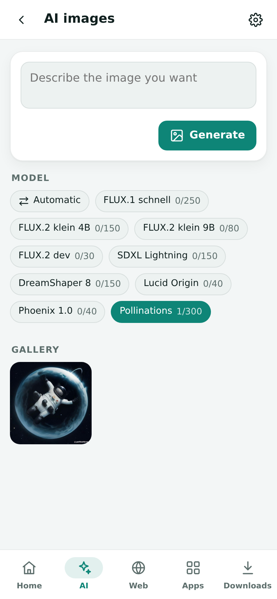
  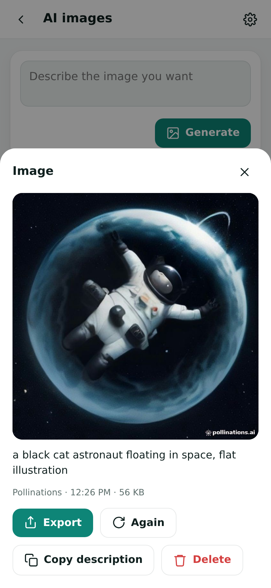

Describe the image and tap **Generate**. Images are kept in the app gallery; open one to try again, copy its description, or export it to the gallery, Files or another chat. In the chat, writing "draw…" works too.

## Web

  

<a href="media/en/clip-web.mp4">MP4 version</a>

  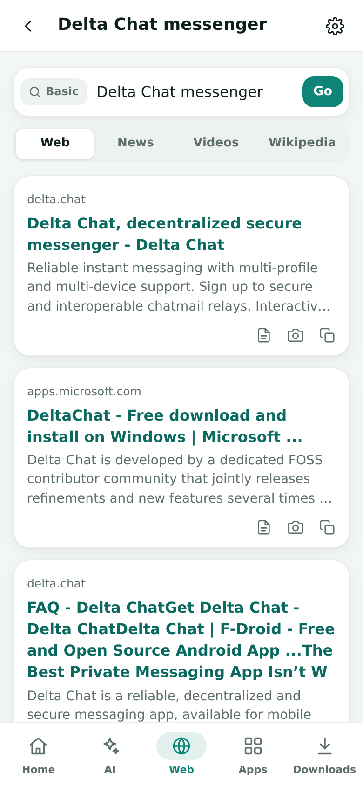
  

- Results show the title, site and a short description. Tap one to open it in the **reader**.
- The reader shows the page as clean, paginated text. Links open in the app, and **Sections** jumps to a heading.
- From any page you can request a **PDF**, a **Screenshot** or a **Download**, or copy the link.
- Recently visited pages are listed in the Web tab.

The default engine and the reader page size can be changed in Settings.

## Apps

  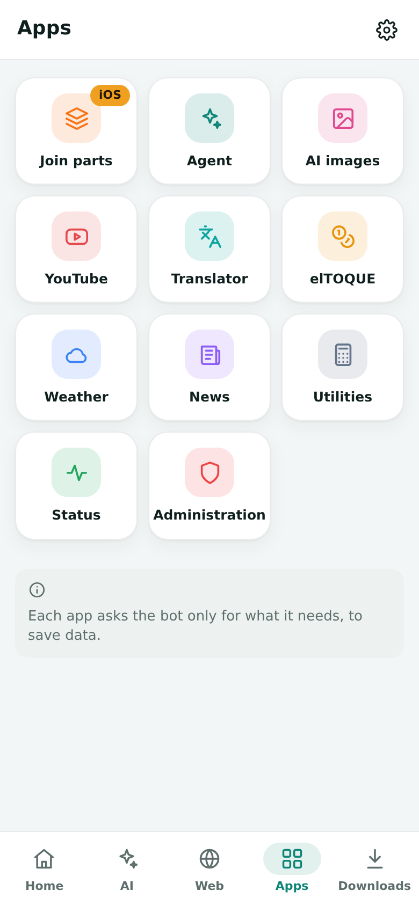
  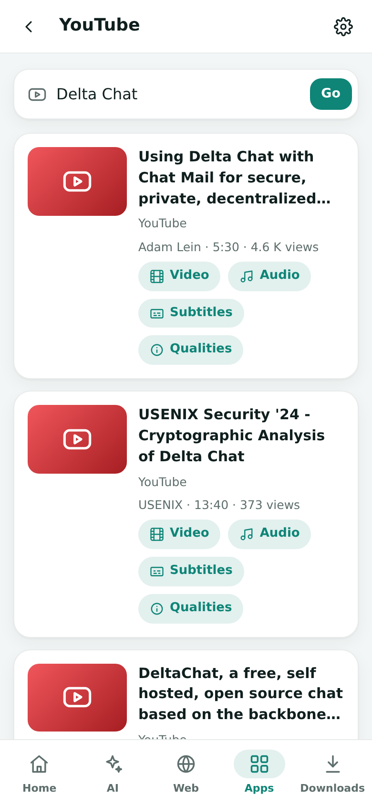
  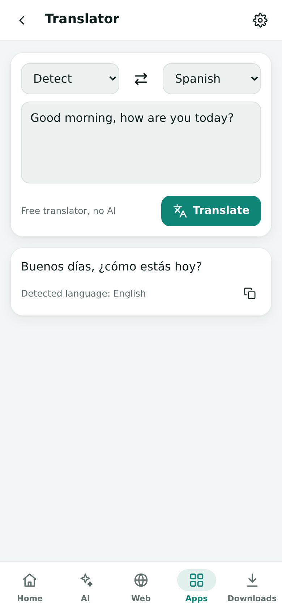

Each app asks the bot only for what it needs, to save data.

| App | What it does |
|---|---|
| **YouTube** | Search videos, then download video or audio in the chosen quality, or read the transcript |
| **Translator** | Free translator without AI, with automatic language detection |
| **elTOQUE** | Informal exchange rates in Cuba, with a converter |
| **Weather** | Forecast for any city |
| **News** | Headlines by topic or by search |
| **Utilities** | Unit converter, local time and calculator |
| **Join parts** | Joins and verifies split files (see below) |
| **Status** | Server, services and quotas |
| **Administration** | Users and access control (owner only) |

  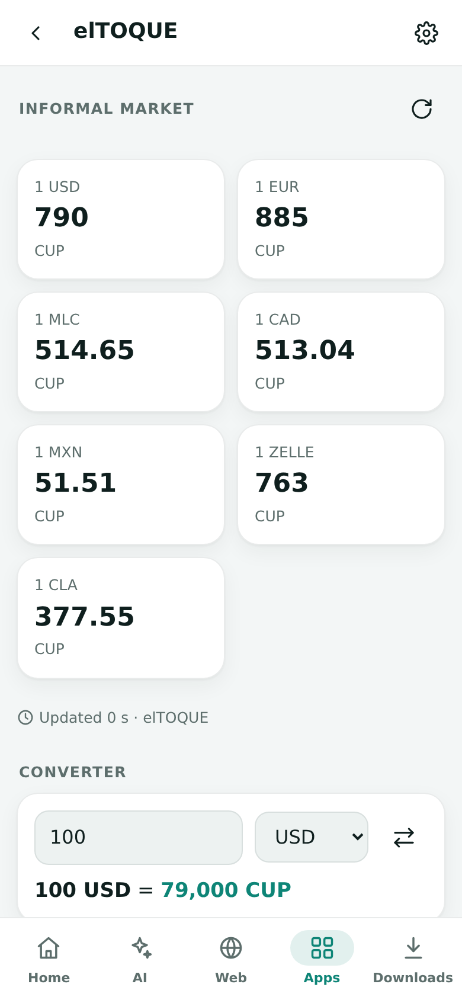
  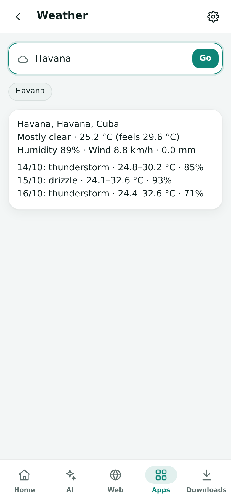
  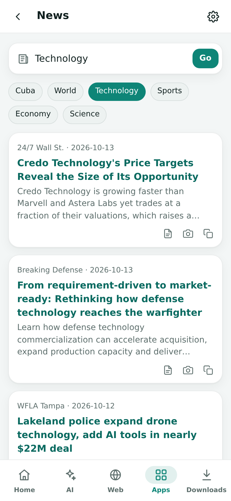
  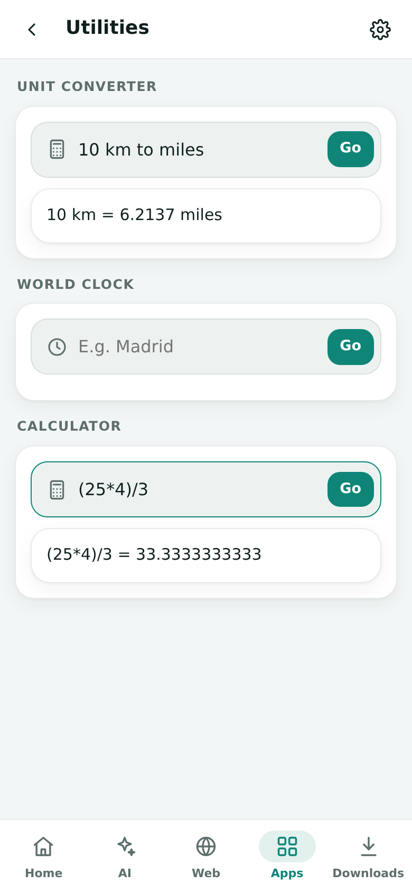

## Downloads

  
  

<a href="media/en/clip-download.mp4">MP4 version</a> (sped up)

Paste a link in the Downloads tab and choose **File**, **Video** or **Audio**, or start a download from the reader or YouTube. Files arrive in the chat as messages, not inside the app.

- **Long videos and audio** arrive as segments named like `Movie (1-5).mp4`. Each one plays on its own.
- **Other files** arrive as `.001`, `.002`… parts. The last part carries the SHA-256 fingerprint of the whole file. With the `packing` setting they can be 7z or zip volumes instead.
- **Mini apps** (`.xdc` files) arrive ready to open in the chat, keeping their name.
- The tab shows progress for every job, and its icon carries a badge with the number of downloads still in progress. You can **pause**, **resume**, **cancel**, **retry**, or **resend** a single missing part.
- **Fair sharing:** when several people use the bot, downloads run two at a time and deliveries alternate part by part, giving the turn to whoever has fewer jobs running and has received less today. Each person can have a limited number of downloads at once (administrators are exempt) and an optional daily quota that only moves them to the back of the line.
- **AI allowance:** people other than administrators have a daily allowance of AI requests (60 by default), images (15) and Coder projects (4), and run one AI request at a time. Only answers that arrive are counted, and a Coder question that builds nothing is free. The AI screen, the chats, the image studio and the Coder show what is left and when it renews (midnight UTC). When less than the reserve (25% by default) of the day's free AI is left, they continue with fast models and the Coder pauses until the renewal.
- Delivery can be throttled: parts per batch, delay between parts, a night window (for example `2200-0600`) and a daily cap in MB.
- Finished jobs are kept for a while (`retention`) so missing parts can be resent.

Reactions on your message show the state: ⏳ while working, then ✅ or ❌.

## Joining parts on iPhone and iPad

  
  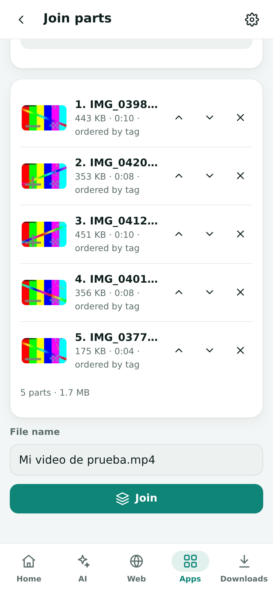

<a href="media/en/clip-join.mp4">MP4 version</a>

iOS has no app that joins `.001` parts. **Join parts** does it inside the mini app:

1. Tap **Choose parts** and select them all from the chat or from Files. Save parts to **Files**, not Photos: Photos renames them and may re-encode videos.
2. The app puts them in order by itself, using the bot's fingerprint of each part, the number stored inside video and audio segments, or the file name. Each row says how its place was found, and media rows show a thumbnail and the duration. Missing parts are listed. You can still move parts by hand.
3. Tap **Join**. The app compares the result with the bot's SHA-256 fingerprint and tells you if it is identical, or which parts are damaged. If the original download is no longer listed, the file is joined but cannot be verified, and the app says so.
4. **Export** the file to the gallery, Files or another chat.

Media segments play on their own, but joining gives one file: MP4, M4A and MP3 segments are joined without re-encoding (WebM and MKV are not supported). On desktop and Android any archive tool or `cat` works too.

## Settings

  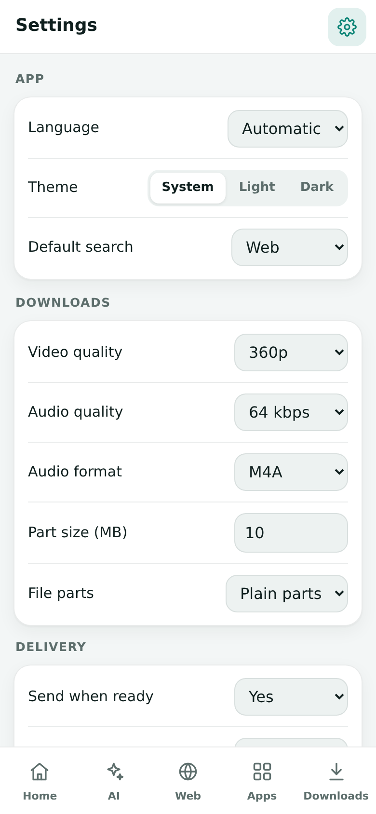

- **App:** language (automatic, Spanish or English), theme (system, light or dark) and default search engine.
- **Bot settings:** downloads, delivery, web and general options, including **Chat use** (app only, or app and commands). They are personal: each person's changes affect only how the bot serves them. A new person starts from the administrator's values; **Back to the initial settings** restores them. Administrators also see the **For everyone** group (downloads at once and daily data quota per person, daily AI allowances, AI reserve, file retention), which applies to all. See the [settings table](../README.md#settings).
- **Device data:** delete AI chats, images, or history and notices. This cannot be undone.

## Status and administration

  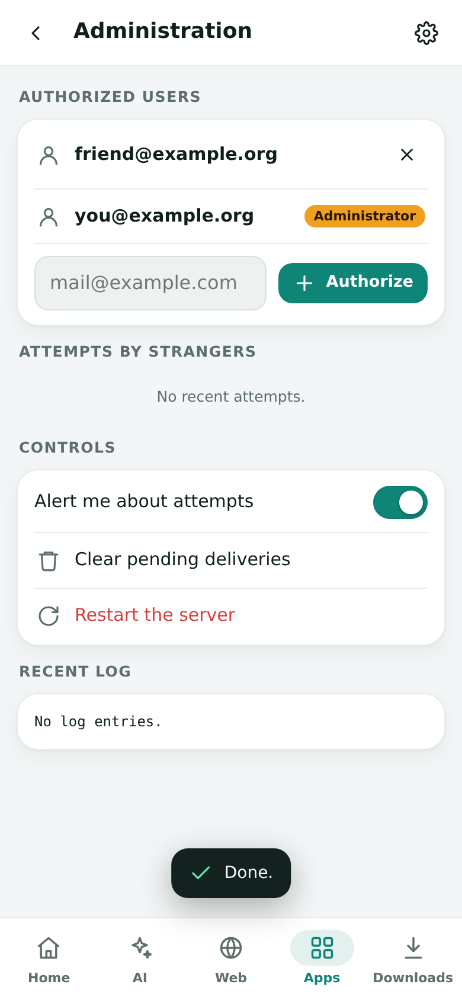

**Status** shows uptime, time until the planned restart, free disk, the queue, the state of each service (search, browser, media) and AI quotas. The server restarts by itself every few hours; pending downloads continue afterwards.

**Administration** (owner only) lists authorized users and foreign contact attempts, and lets you allow, remove, block or unblock addresses, read recent warnings and errors, toggle alerts, clean temporary files and restart the server. Unknown senders never get a reply: the owner receives one alert and the contact is blocked.

It also includes:

- **Performance:** CPU use and load, memory (total and the bot's own), disk (free space and the downloads folder), network rate, response times of quick and heavy requests, threads and the queue.
- **Usage and fair sharing:** each person's share of the data delivered over seven days, with request and download counts. A person using more than half of the traffic while others also use the bot is marked as disproportionate. Only amounts are recorded, never what anyone asked for. The AI line shows the allowances, the reserve and how much of the day's free AI is left. You can pause one person's downloads, pause the whole queue or reset the counters.
- **Server:** hosting, system image, processor, session number, start time, time until the planned restart, and whether a newer version is waiting.
- **Stress test:** about 15 seconds of CPU, memory, disk, download speed and messaging-core checks, bounded so it never fills the disk.

## Classic chat mode

The bot works through the mini app by default. Setting **Chat use** to *App and commands* (`chat` = `full`) also enables writing normally in the chat ("what is photosynthesis", "weather in Havana", a plain link) and these commands. Each has an English and a Spanish name; tapping one fills the input box.

- **Help and app:** `/help` (`/ayuda`), `/app`
- **Web:** `/web`, `/pdf`, `/screenshot` (`/captura`), `/search` (`/buscar`), `/videos`, `/summary` (`/resumen`)
- **Downloads:** `/video`, `/audio`, `/download` (`/bajar`), `/transcript` (`/subtitulos`), `/queue` (`/cola`), `/pause` (`/pausar`), `/resume` (`/seguir`), `/cancel` (`/cancelar`), `/retry` (`/reintentar`), `/resend` (`/reenviar`), `/schedule` (`/programar`)
- **AI:** `/ai` (`/ia`), `/img`, `/model` (`/modelo`), `/reset` (`/olvidar`)
- **Utilities:** `/translate` (`/traducir`), `/convert` (`/convertir`), `/time` (`/hora`), `/weather` (`/clima`), `/rate` (`/tasa`), `/news` (`/noticias`), `/calc`
- **Account:** `/settings` (`/ajustes`), `/status` (`/salud`), `/github`, `/purge` (`/limpiar`), `/admin`

## Saving data

- Use the Agent before the models.
- Lower the video or audio quality in Settings.
- Reduce the reader page size and keep reader images off.
- Schedule a night delivery window and set a daily cap.
- Keep notices on `minimal`.

## Privacy

The bot is private and only answers authorized addresses. AI chats and images are stored only on your device. The server never stores prompts, answers or downloaded files, and removes temporary files after one hour.

  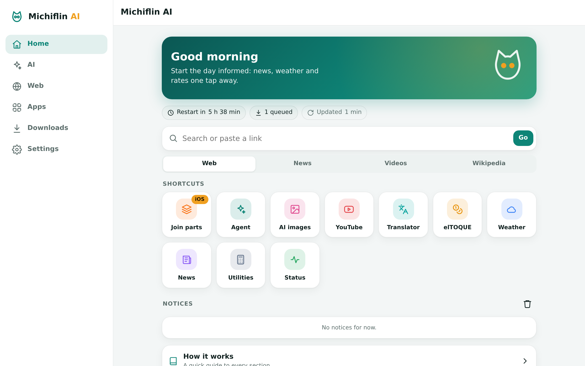

